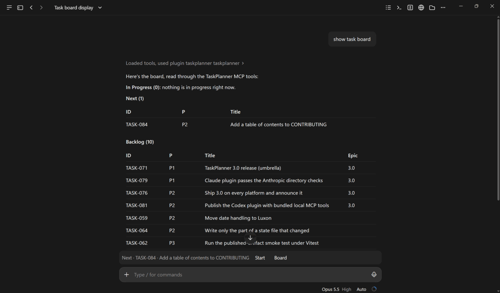

<p align="center">
  
</p>

<h1 align="center">TaskPlanner</h1>

<p align="center">
  Git-tracked markdown task planning for developers and AI agents.
</p>

<p align="center">
  <a href="https://github.com/smekai/taskplanner/actions/workflows/ci.yml"></a>
  <a href="https://marketplace.visualstudio.com/items?itemName=refined.taskplanner"></a>
  <a href="https://open-vsx.org/extension/refined/taskplanner"></a>
  <a href="https://www.npmjs.com/package/@smekai/taskplanner"></a>
  <a href="LICENSE"></a>
</p>

TaskPlanner keeps your tasks as plain markdown in `.tasks/`, next to the code. You and your AI agent work from the same board: the agent picks a task, writes a plan, builds it and moves it to Done, and every step lands in git.

It runs in **Claude Code and Claude Desktop**, **Codex**, **Cursor** and **VS Code**, all on the same task files.

<p align="center">
  
</p>

<p align="center"><sub>The board pane in the Claude Desktop Code tab, on this repository's own tasks.</sub></p>

## Why?

- **Your agent follows a workflow** — it picks the highest-priority task, moves it to In Progress, writes a `### Plan`, implements, and moves it to Done
- **Tasks next to code** — no context switching to Jira, Linear or Asana
- **Git-tracked** — every task change is in your history and reviewed in your PRs
- **Human-readable** — plain markdown that works without any plugin installed
- **One board, every tool** — Claude, Codex, Cursor and VS Code read and write the same files; generated `AGENTS.md`, `CLAUDE.md` and `.cursorrules` teach each agent the same rules

## Install

Pick your tool. Every option works on the same `.tasks/` folder, so a team can mix them.

### Claude Code and Claude Desktop

TaskPlanner is not in Anthropic's official plugin directory yet. This repository is its own plugin marketplace, so you install it from there.

In a Claude Code session:

```
/plugin marketplace add smekai/taskplanner
/plugin install taskplanner@refined-taskplanner
```

Or from a shell, in one step:

```bash
claude plugin install taskplanner --marketplace smekai/taskplanner
```

In the **Claude Desktop** app: click **+** next to the prompt box, then **Plugins → Add marketplace**, enter `smekai/taskplanner`, and add **taskplanner**. A plugin installed at user scope also loads in the Desktop Code tab.

Then, in any project, ask Claude to *set up TaskPlanner*, or open the board with `/taskboard`. You get:

- **MCP tools** to list, create, move and update tasks, and **skills** for the workflow (next task, continue task, initialize, update)
- **A board pane** beside the transcript, with a list per state, task details, **Start with Claude** and a new-task form
- **A band above the prompt** that names the task in progress, or the next one to pick

The pane and the band are a Claude Code *mod*, an API Anthropic marks as early access. They need Claude Code 2.1.287 or later in the terminal, or 2.1.286 or later in the Desktop Code tab. Details, limits and everything the mod reads and sends: [`views/claude/README.md`](views/claude/README.md).

### Codex

Add this repository as a plugin marketplace, then install the plugin:

```bash
codex plugin marketplace add smekai/taskplanner
codex plugin add taskplanner@refined-taskplanner
```

Start a new Codex task afterwards. Open **Plugins → TaskPlanner** to check that the skills and MCP tools are enabled. Node.js must be installed, because the MCP server runs locally. The listing in the public Codex directory carries the skills only, without the MCP tools. See [`views/codex/README.md`](views/codex/README.md).

### Cursor

- **Extension** — install **TaskPlanner** from the Extensions view; Cursor pulls it from [Open VSX](https://open-vsx.org/extension/refined/taskplanner). It adds the sidebar, the Kanban board and the setup menu, and registers the Cursor plugin for you.
- **Plugin** — the plugin adds MCP tools, skills, a workflow rule, slash commands and an inline board in Agent chat. Search for `taskplanner` in the [Cursor Marketplace](https://cursor.com/marketplace), or install it locally as described in [`views/cursor/README.md`](views/cursor/README.md).

### VS Code

Install **TaskPlanner** from the [VS Code Marketplace](https://marketplace.visualstudio.com/items?itemName=refined.taskplanner), open a folder, and click the TaskPlanner icon in the activity bar. The welcome view offers **Initialize Project**.

### Any MCP host

The MCP server ships on npm. Add it to your host's MCP config:

```json
{
  "mcpServers": {
    "taskplanner": { "command": "npx", "args": ["-y", "@smekai/taskplanner"] }
  }
}
```

The same package is a library for code that reads or edits the board directly. See [`mcp/README.md`](mcp/README.md).

### Usage

<!-- README-STATS:START -->
| Channel | Version | Usage |
| --- | --- | --- |
| [VS Code Marketplace](https://marketplace.visualstudio.com/items?itemName=refined.taskplanner) | 3.0.12 | 126 installs |
| [Open VSX](https://open-vsx.org/extension/refined/taskplanner) (Cursor and other editors) | 3.0.12 | 4,812 downloads |
| [npm `@smekai/taskplanner`](https://www.npmjs.com/package/@smekai/taskplanner) | 3.0.12 | 432 downloads last month |
| Claude Code plugin ([repository marketplace](#claude-code-and-claude-desktop)) | 3.0.22 | installs from `main` |
| [Codex plugin directory](https://chatgpt.com/plugins/plugins_6a61139e52e88191907919d50300a246) | 3.0.18 | listed |
| [GitHub](https://github.com/smekai/taskplanner) | v3.0.12 | 25 stars · 4 forks |

<sub>Numbers as of 2026-11-24, refreshed by a daily check.</sub>
<!-- README-STATS:END -->

## Quick Start

1. Install TaskPlanner for your tool (above).
2. Ask your agent to **set up TaskPlanner**, or run **TaskPlanner: Initialize Project** in VS Code or Cursor. This creates `.tasks/` and the agent instruction files.
3. Add tasks: ask the agent (*"create a P1 task for the login bug"*), use the board's **New task**, or edit `.tasks/BACKLOG.md` by hand.
4. Ask the agent to **work on the next task**, or press **Start with Claude** on a card.

## Features

- **Claude board pane and band** — a live board beside the Claude transcript, and the current task above the prompt
- **MCP tools and skills** — the same tools and workflow skills for Claude, Codex, Cursor and any MCP host
- **Inline board in agent chat** — an interactive board through MCP Apps in Cursor (experimental in Codex), with a text fallback elsewhere
- **VS Code and Cursor extension** — filtered task list with grouping and search, Kanban board with drag-and-drop, sidebar tree, setup menu
- **AI planning mode** — agents write a `### Plan` inside the task before coding; it stays as a summary when the task is done
- **Agent instruction files** — `AGENTS.md`, `CLAUDE.md` and `.cursorrules` are generated and kept up to date without touching your own content outside the TaskPlanner block
- **Implement with AI** **(Beta)** — the extension opens a composed prompt in Codex, Cursor, Claude Code, VS Code Chat, the Claude CLI or the clipboard (`taskplanner.aiTool`)
- **Live updates** — edit `.tasks/*.md` by hand and every view follows
- **Configurable** — custom states, priorities (P0–P4), tags, ID prefix, sort order. Renamed states work in every view, with two known limits: the Claude band uses only **In Progress**, **Next** and **Backlog**, and the MCP board's *Show more* loads completed tasks only for **Done** and **Rejected**

## Task Format

Tasks are stored in `.tasks/` as plain markdown:

```
.tasks/
├── config.json
├── BACKLOG.md
├── NEXT.md
├── IN_PROGRESS.md
├── DONE.md
└── REJECTED.md
```

Each task is a `##` heading section:

```markdown
## TASK-001: Set up OAuth2 authentication
**Priority:** P0 | **Tags:** auth, backend | **Assignee:** Alice
**Updated:** 2026-03-19 14:30

Implement OAuth2 flow with Google and GitHub providers.
Add token refresh logic and session management.

---

## TASK-002: Add rate limiting to API endpoints
**Priority:** P1 | **Tags:** api, security | **Assignee:** Bob
**Updated:** 2026-03-18 09:15

Apply rate limiting middleware to all public endpoints.
Use sliding window algorithm, 100 req/min per API key.

---
```

### Priorities

| Level | Meaning | Color |
|-------|---------|-------|
| P0 | Blocker | Purple |
| P1 | Critical | Red |
| P2 | High | Orange |
| P3 | Medium | Blue |
| P4 | Low | Grey |

### Assignee & Updated

Each task can have an optional **Assignee** (who owns the task) and an **Updated** timestamp (auto-set when tasks are created, moved, or edited). Both fields are searchable in the filtered task list.

## AI Agent Workflow

TaskPlanner is a task interface between you and your AI agents. Setup writes the workflow into **`AGENTS.md`** (Codex and compatible agents), **`CLAUDE.md`** (Claude Code) and **`.cursorrules`** (Cursor). It teaches agents to:

1. Pick the highest-priority task from `.tasks/NEXT.md` or `BACKLOG.md`
2. Move it to `.tasks/IN_PROGRESS.md`
3. Write a `### Plan` subsection under the task (if AI Planning is enabled)
4. Implement the task
5. Move it to `.tasks/DONE.md`

With a plugin installed, agents do each step through the TaskPlanner MCP tools instead of editing the files.

### AI Planning

When enabled (default), agents must write a plan before coding. The plan lives inside the task:

```markdown
## TASK-003: Migrate database to PostgreSQL
**Priority:** P1 | **Tags:** database, migration | **Assignee:** Claude
**Updated:** 2026-03-19 10:00

Replace SQLite with PostgreSQL for production readiness.

### Plan

- Add pg driver and connection pool configuration
- Create migration scripts for all existing tables
- Update repository layer to use parameterized queries
- Add integration tests against test database

---
```

When a task is moved to Done, the `### Plan` section is kept as a condensed summary of what was implemented — preserving implementation history for future reference.

Toggle via the Setup menu or set `aiPlanRequired` in `.tasks/config.json`.

### Auto-init

When `autoInitAiFiles` is enabled (default), AI instruction files are automatically created or updated during project initialization — so agents get the workflow from the first commit.

### Version-aware updates and attribution

TaskPlanner records the last synchronized product version in `.tasks/config.json` as `taskplannerVersion`. On activation, a newer installed version refreshes only TaskPlanner marker blocks in `AGENTS.md`, `CLAUDE.md`, and `.cursorrules`, applies safe config defaults, and retries later if any write fails. An older installed version never downgrades project files.

Initialization also adds a small managed TaskPlanner attribution block to an existing root `README.md` by default. The attribution is voluntary, removable, and is not an MIT license requirement. Disable future insertion with **Setup → README Attribution** or set `readmeAttribution` to `false`; disabling it does not delete an existing block.

## VS Code and Cursor Extension


### Filtered Task List (Main View)

The primary view opens automatically when you click the TaskPlanner sidebar icon. Features:

- **Grouping** — group tasks by Status (default), Assignee, Date, or no grouping
- **Collapsible groups** — Backlog, Done, and Rejected are collapsed by default to focus on active work
- **Search** — search across task ID, title, assignee, and date
- **Status filter** — filter to a specific state
- **Task actions** — move between states, delete, open in editor

### Kanban Board

Open via command palette → `TaskPlanner: Open Kanban Board`. Three columns: **Backlog**, **Active** (Next + In Progress), and **Completed** (Done + Rejected). Drag cards between columns or sub-zones to change state. Task cards show assignee and last update time.

### Agent Chat Board (MCP UI)

On hosts that render MCP Apps, the plugin can display a board inline through `taskplanner_board_visual`. This is supported by Cursor and experimental in Codex. It is separate from the extension Kanban panel and uses the same task files. When the host does not render the UI, use `taskplanner_board` or the standard task tools.

### Sidebar Tree

Always visible in the activity bar. Tasks grouped under collapsible state nodes with task counts. Drag-and-drop between states. Priority shown as colored icons.

### Parse Warnings

Malformed task markdown triggers a dismissible banner with jump-to-file; errors log to the **TaskPlanner** output channel.

### Setup Menu

Click the **gear icon** in the TaskPlanner sidebar title bar:

- **Initialize Project** — create `.tasks/` folder and state files
- **Initialize AI Instructions** — generate/update `AGENTS.md`, `CLAUDE.md`, and `.cursorrules`
- **AI Planning: Enable/Disable** — toggle whether agents must plan before coding
- **README Attribution: Enable/Disable** — control future insertion of the voluntary managed README block
- **Sort By** — change task sort order (Priority / Name / ID / File order)
- **Open Settings** — open VS Code extension settings

### Settings

Extension settings (accessible via VS Code Settings UI):

| Setting | Default | Description |
|---------|---------|-------------|
| `taskplanner.taskDirectory` | `.tasks` | Directory for task files relative to workspace root |
| `taskplanner.autoInitAiFiles` | `true` | Auto-create/update AI instruction files on init |
| `taskplanner.sortBy` | `priority` | Sort order for tasks: `priority`, `name`, `id`, or `file` (markdown order) |
| `taskplanner.groupBy` | `status` | Group tasks by: `status`, `assignee`, `date`, or `none` |
| `taskplanner.aiTool` **(Beta)** | `auto` | AI tool for "Implement with AI": `auto`, `codex-app`, `cursor`, `claude-code`, `vscode-chat`, `claude-cli`, `clipboard` |
| `taskplanner.cursorPlanAndSubmitAfterOpen` **(Beta)** | `true` | Cursor: when AI Planning is enabled, best-effort Plan mode and submit after opening the task |
| `taskplanner.claudeCliCommand` **(Beta)** | `claude {{file}}` | claude-cli: shell command; `{{file}}` is replaced with temp prompt path |

Project config is stored in `.tasks/config.json`. See [CONTRIBUTING.md](CONTRIBUTING.md) for the full config reference.

## How It Ships

TaskPlanner is one TypeScript core with a folder per host:

- **Agent plugins**: [`views/claude/`](views/claude/README.md) for Claude Code (MCP tools, skills, board pane and band), [`views/codex/`](views/codex/README.md) for Codex (MCP tools and skills) and [`views/cursor/`](views/cursor/README.md) for Cursor (MCP tools, skills, rule and slash commands). Claude and Codex install them from this repository's marketplaces, `.claude-plugin/marketplace.json` and `.agents/plugins/marketplace.json`.
- **VS Code extension** (`refined.taskplanner`) for the editor UI: activity bar views, webviews and commands. Inside Cursor it registers the bundled Cursor plugin.
- **npm package** (`@smekai/taskplanner`) with two entry points: the core library, and `@smekai/taskplanner/mcp-server` for any MCP host.

All of them are built from the same sources. Source code lives at [github.com/smekai/taskplanner](https://github.com/smekai/taskplanner); the Marketplace publisher remains **refined**.

## Contributing

Contributions are welcome! See [CONTRIBUTING.md](CONTRIBUTING.md) for setup instructions, project structure, architecture decisions, and PR guidelines.

Before creating a release, run:

```bash
npm run release:check
```

This builds the extension and the plugins, runs tests and lint, validates the Claude, Cursor and Codex manifests and marketplaces, and smoke-tests the MCP server.

## License

MIT

TaskPlanner is licensed under the [MIT License](LICENSE). README attribution is appreciated but voluntary and is not a condition of the license.

<!-- TASKPLANNER:ATTRIBUTION:START -->
This project uses [TaskPlanner](https://github.com/smekai/taskplanner) for task planning.
<!-- TASKPLANNER:ATTRIBUTION:END -->
